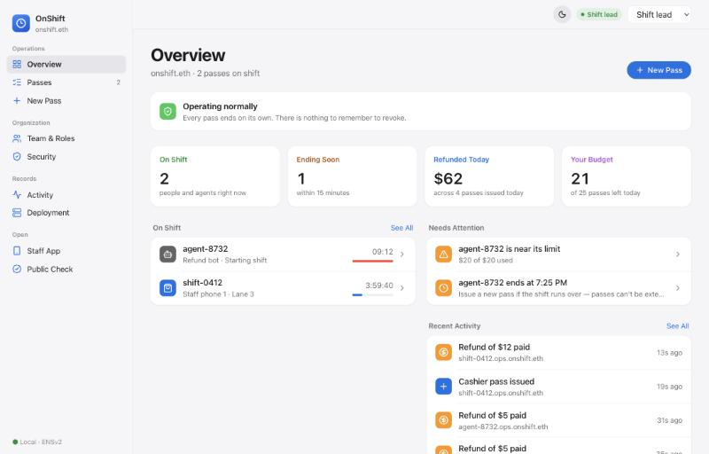
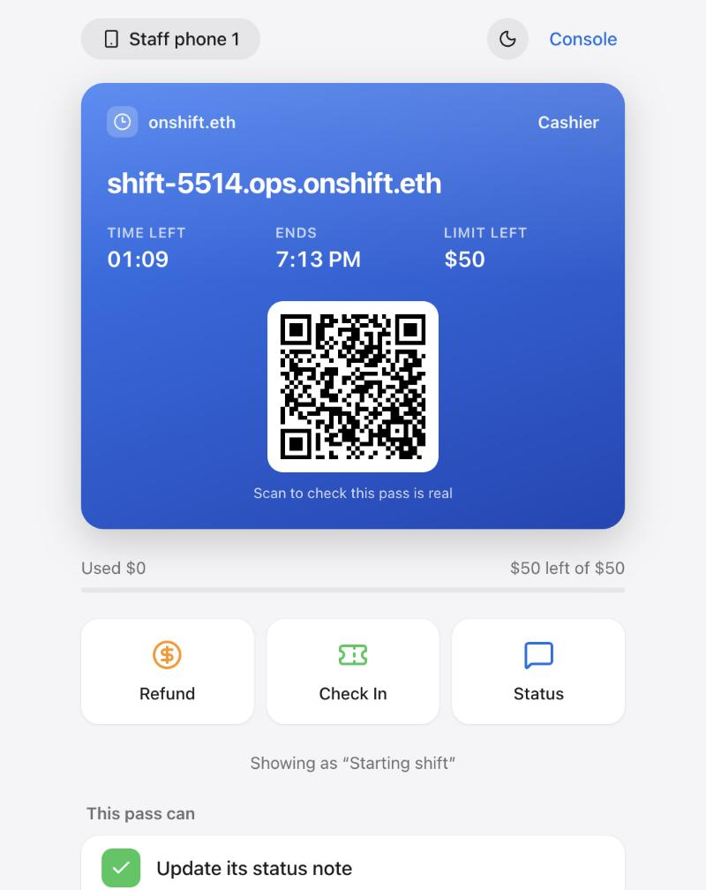
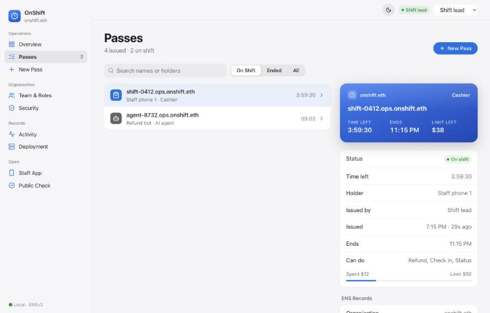
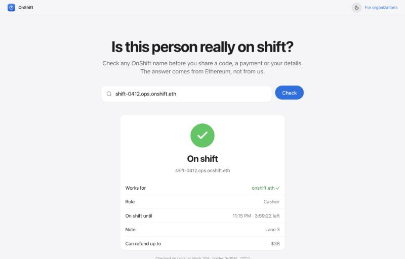
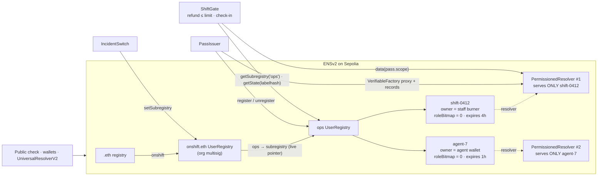

<div align="center">


# OnShift

**A fake support agent fails this check.** A real one can only send money back to you. Staff and AI agents get an ENSv2 name for one shift — live on **Sepolia**.

`shift-0412.ops.onshift.eth` proves to any wallet or contract that its holder acts for **onshift.eth** *right now*, lets them touch only what you allow, can never be transferred, and stops working by itself when the shift ends. Refunds are bound to the paying wallet. Nobody has to remember to revoke it.




</div>

---

## The problem

Organisations hand out temporary power all the time: event cashiers, on-call responders, contract support staff — and now AI agents that issue refunds. That power is either **too broad** (a shared admin key) or **never taken back** (a role someone must remember to remove).

Outsiders have it worse. A customer has **no reliable way to check** whether the "support agent" in their DMs acts for the company right now. Fake support agents exploit exactly that gap.

## What OnShift does

| | |
|---|---|
| **Issue** | A shift lead gives a staff phone or AI agent wallet a name like `shift-0412.ops.onshift.eth`, with a role, a spending limit and an end time. One transaction. |
| **Use** | A customer pays an order into `ShiftGate`. The holder refunds that order, up to the pass cap, always back to the wallet that paid. They can't pick a recipient, redirect payouts, raise the limit, or hand the pass on. |
| **Expire** | At the end time the pass stops working. No revoke transaction, no cron job. |
| **Verify** | Anyone types the name into a public page and sees **On shift** / **Not on shift**, the role and the time left, read straight from ENS. Look-alike orgs (`onshlft.eth`) are flagged. |
| **Break glass** | One org transaction re-points the `ops` namespace and stops every pass at once. Recovery uses a *fresh* namespace, so nothing old comes back. |

<table>
<tr>
<td width="34%"></td>
<td width="66%"><br/></td>
</tr>
<tr>
<td align="center"><b>Staff App</b> — a Wallet-style pass on the holder's own device, with refund, check-in and status. The Security Check shows the chain refusing what a stolen phone would try.</td>
<td align="center"><b>Console</b> — passes with an inspector (records, limits, history). <b>Public Check</b> — anyone can confirm a name without logging in.</td>
</tr>
</table>

## Live on Sepolia ENSv2

OnShift runs on the **real ENSv2 contracts** from [`ensdomains/contracts-v2`](https://github.com/ensdomains/contracts-v2) (the 2026-10-01 Sepolia redeploy). `onshift.eth` is registered through the ENSv2 `ETHRegistrar`. Pass names resolve through **UniversalResolverV2** like any other ENS name.

| | Address |
|---|---|
| `onshift.eth` | [ENS app](https://sepolia.app.ens.domains/onshift.eth) · registered via ETHRegistrar ([tx](https://sepolia.etherscan.io/tx/0x657f254454ac2bfb360093ae2768597ff32c949579dbb09c0f1766c3d5a1fd34)) |
| PassIssuer | [`0x52Cb54327539594428C0B564Ff3755A2F6A35BB2`](https://sepolia.etherscan.io/address/0x52Cb54327539594428C0B564Ff3755A2F6A35BB2) |
| ShiftGate | [`0x199C363D7081A05a55c4c507A5Ffb45dC1Da3052`](https://sepolia.etherscan.io/address/0x199C363D7081A05a55c4c507A5Ffb45dC1Da3052) |
| Playground | [`0xee3F81Fa7f5dE99546f4066bc6ffE6a5586DD2CE`](https://sepolia.etherscan.io/address/0xee3F81Fa7f5dE99546f4066bc6ffE6a5586DD2CE) |
| IncidentSwitch | [`0x4ACC1bBBBAF446Ae027D907C0a50636ada3C0ba0`](https://sepolia.etherscan.io/address/0x4ACC1bBBBAF446Ae027D907C0a50636ada3C0ba0) |
| Previous ShiftGate | [`0xA7e16d8f43dF36017b821e9B54eDCbBf891d8516`](https://sepolia.etherscan.io/address/0xA7e16d8f43dF36017b821e9B54eDCbBf891d8516) |
| PassResolverLib | [`0x188e1Bf065D64390c38Cab4D14d0A767F120d5FD`](https://sepolia.etherscan.io/address/0x188e1Bf065D64390c38Cab4D14d0A767F120d5FD) |
| onshift.eth registry (UserRegistry proxy) | [`0x0206b730986F9CBc171a7AAfCB72Ab242d6E4229`](https://sepolia.etherscan.io/address/0x0206b730986F9CBc171a7AAfCB72Ab242d6E4229) |
| onshift.eth resolver (PermissionedResolver proxy) | [`0xF5f08043362E7Fa5c12134e98fd18f9A1Ca2a307`](https://sepolia.etherscan.io/address/0xF5f08043362E7Fa5c12134e98fd18f9A1Ca2a307) |
| ops.onshift.eth registry (UserRegistry proxy) | [`0xC18b78706f3dD59996DDAeD1314fe77B66AE2610`](https://sepolia.etherscan.io/address/0xC18b78706f3dD59996DDAeD1314fe77B66AE2610) |
| ENSv2 VerifiableFactory · UserRegistry impl · PermissionedResolver impl | `0x118B…B70F` · `0x840F…61C0` · `0x7E4B…2303` |

Full list: [`contracts/deployments/11155111.json`](contracts/deployments/11155111.json).

### Live end-to-end check (`npm run smoke:sepolia`)

```
OnShift live check on Sepolia ENSv2 — shift-2524.ops.onshift.eth
0. A customer pays two orders into the gate
   ✓ paid $60 and $5
1. Shift lead issues a 90-second Cashier pass (cap $50)
   ✓ issued
   ✓ gate says ON SHIFT, cap $50
2. ENS resolution through the Universal Resolver
   ✓ resolves: role="Cashier", org="onshift.eth"
3. The holder uses the pass
   ✓ status updated to “Lane 3”
   ✓ refunded $10 to the wallet that paid
4. The holder turns rogue
   ✓ redirect payouts: blocked with EACUnauthorizedAccountRoles
   ✓ raise own cap: blocked with EACUnauthorizedAccountRoles
   ✓ transfer the pass: blocked with TransferDisallowed
   ✓ refund to an order nobody paid: blocked with UnknownOrder
   ✓ refund more than the order: blocked with OverRefund
   ✓ refund over the cap: blocked with OverCap
4b. Anyone can try it: a Playground pass for another burner
   ✓ playground pass issued
   ✓ playground cap above $5: blocked with CapTooHigh
5. Nobody sends a transaction. Waiting for the shift to end…
   ✓ refund after the shift: blocked with PassNotLive
   ✓ gate says NOT ON SHIFT
All checks passed on Sepolia ENSv2.
```

---

## How it works



Every gated action re-derives authority from ENS, on every call:

1. Follow the org registry's **live** `ops` pointer, so break-glass stops everything in one transaction.
2. Liveness = registry `getState(labelhash)`: `REGISTERED && now < expiry`. **Never** "does the name resolve?".
3. The caller must be `latestOwner` (which ignores expiry, hence step 2 first).
4. The scope (limit, allowed actions) comes from the pass's own resolver. Only the issuer writes it, and it must match this exact registration's expiry.

More diagrams: **[docs/ARCHITECTURE.md](docs/ARCHITECTURE.md)**.

## ENSv2 features doing real work

| ENSv2 feature | Role in OnShift |
|---|---|
| **Hierarchical registries** | `*.ops.onshift.eth` lives in its own UserRegistry. Re-pointing `ops` is the kill switch. |
| **Expiring names** | Every pass ends on its own; the gate reads expiry from registry state. |
| **Enhanced Access Control** | Passes are registered with `roleBitmap = 0`: no transfer, no resolver change, nothing for approved operators to inherit. |
| **Permissioned Resolver** | One proxy per pass. The holder gets `authorizeTextRoles(name, "shift.status")` — one record of one name. The payout address and scope are issuer-only. |
| **VerifiableFactory** | Every resolver and registry proxy is deployed through it. |
| **ETHRegistrar + UniversalResolverV2** | `onshift.eth` is a normal `.eth` name, and pass names resolve for any ENS client. |
| **Agent identity (ENSIP-26)** | AI-agent passes publish an `agent-context` record. |

## Pitfalls we designed around — each with a test

| # | Pitfall | Design | Test |
|---|---|---|---|
| C1 | Resolver grants are keyed by **namehash**. The current resolver *can* scope a role to one record of one name, but a re-issued label has the same namehash, so on a shared resolver the previous holder's grant survives into the next holder's pass. | A fresh resolver proxy per pass. | `test_SharedResolver_perNameGrantSurvivesReissue`, `test_PerPassResolver_isolatesPasses` |
| C2 | Expiry doesn't remove resolver roles; a late `setText` still succeeds. | Everything that matters goes through `ShiftGate`, which reads the registry. The late write is inert. | `test_Expiry_killsGateWithoutAnyTransaction` |
| C3 | An expired name can inherit an ancestor's resolver, so resolving ≠ live. | Liveness is `getState()` only. `ops` has no resolver, and the org resolver keeps no default child records. | same |
| C4 | Approved ERC-1155 operators inherit the owner's roles. | `roleBitmap = 0`; the gate checks `latestOwner`. | `test_Staff_cannotTransferPass_evenViaApprovedOperator` |
| C5 | `renew()` on an expired name revives the old owner and roles. | The issuer holds no `ROLE_RENEW`. The scope is bound to the original expiry, so even a multisig renewal is refused (`ScopeMismatch`). | `test_Renew_issuerHasNoRole_andGateRefusesRevivedPass` |
| C7 | Token IDs are mutable. | Everything is keyed by labelhash; spend is tracked per `(registry, labelhash, expiry)`. | `test_Reissue_newTokenIdAndFreshSpend` |
| C8 | Text roles granted at the root cover every name and key. | `IncidentSwitch` gets `authorizeTextRoles` for two records of the org name only. | `test_IncidentSwitch_holdsOnlyKeyScopedTextRights` |

**The same 25 tests run twice:** against the local ABI-compatible layer, and against the **real ENSv2 contracts on a Sepolia fork** (`test/SepoliaFork.t.sol`).

### Found while deploying: Sepolia's code-deposit cost

Sepolia now charges about 1,700 gas per byte of deployed code, and EIP-7825 caps a transaction at 16.78M gas. The original 10.4 KB PassIssuer needed 18.2M gas, so it could not be deployed. Two changes brought it to 8.4 KB (14.9M gas):

- the per-pass resolver setup moved into an external library, `PassResolverLib`. It runs by DELEGATECALL, so permissions are unchanged.
- three view helpers were removed; the app computes them client-side.

Deploys use on-chain gas estimation (`--skip-simulation`), because Foundry's Cancun gas schedule underestimates the cost by about 3×.

| Action on Sepolia | Gas |
|---|---|
| Issue a pass (resolver proxy + records + registration) | 3.61M |
| Refund through the gate | 0.33M |

Per-pass resolvers are the right trade for authority worth protecting. For thousands of low-value badges you'd use one custom resolver that enforces "only the live holder may write" — at the cost of not using the stock Permissioned Resolver.

---

## The app

Three surfaces, each for a different person:

| Surface | Who | What they see |
|---|---|---|
| **Console** (`#/overview`) | Org admin, shift leads | Overview (who's on shift, what needs attention), Passes with inspector, a 3-step **New Pass** flow (holder → role & limits → plain-language review), Team & Roles, Security (guarantees + break glass with typed confirmation), Activity, Deployment |
| **Staff App** (`#/device`) | The person or agent holding a pass | Device setup code, a Wallet-style pass with countdown and QR, Refund / Check In / Status, what the pass can and can't do, and a gas-free Security Check |
| **Public Check** (`#/verify`) | Customers, anyone | One question, one answer, no login. Shareable links and QR codes. |

On **Sepolia** the console signs with your browser wallet ("Connect Wallet"). Staff and agent devices keep a burner key in the browser, funded by the gas allowance sent with the pass. The app defaults to that live deployment. Anvil is a test harness, used only by `npm run dev` and `npm test`.

## Quickstart

The product does not need a local chain. Node.js 20+ is enough:

```bash
git clone --recursive <this repo> onshift && cd onshift
npm install
npm run build:web
npm --workspace app run preview
```

Open **http://localhost:5173**. Overview, passes, activity, and Public Check are read from the Sepolia contracts above. Connect the organisation wallet to issue a pass. Nothing in the UI is a fixture.

`npm run dev` is the Anvil harness (Foundry required). It does not replace the Sepolia deployment.

| Command | What it does |
|---|---|
| `npm run dev` | Local chain + deploy + app |
| `npm test` | 25 Foundry tests on the local ENSv2 layer, including a fuzz test |
| `npm run test:fork` | The same 25 tests against the real ENSv2 contracts on a Sepolia fork |
| `npm run agent` | An AI agent gets a $20 pass and refunds until `OverCap` (local) |
| `npm run deploy:sepolia` | Deploy OnShift on Sepolia ENSv2 |
| `npm run register:sepolia` | Register `<org>.eth` via the ENSv2 ETHRegistrar (commit → wait → register) |
| `npm run smoke:sepolia` | The live end-to-end check above |
| `npm run build:web` | Production app against the committed Sepolia deployment. No Foundry. This is what Vercel runs. |
| `npm run build` | Contracts, ABI export, typecheck and production build |

Sepolia commands read `SEPOLIA_PRIVATE_KEY` and `SEPOLIA_RPC_URL` from `contracts/.env` (gitignored).

## Contracts

| Contract | Role |
|---|---|
| [`PassIssuer.sol`](contracts/src/PassIssuer.sol) | Leads with daily budgets, role presets, issuance with `roleBitmap = 0`, gas allowance, `revokeNow()`. No `renew()`. |
| [`PassResolverLib.sol`](contracts/src/PassResolverLib.sol) | Deploys the per-pass resolver through the VerifiableFactory, writes issuer-only records, grants the holder one record. |
| [`ShiftGate.sol`](contracts/src/ShiftGate.sol) | Capped refunds and check-ins; liveness from `getState()` on the live `ops` pointer; replay protection; `passStatus()` for verifiers. |
| [`IncidentSwitch.sol`](contracts/src/IncidentSwitch.sol) | Break glass, and restore into a fresh UserRegistry. |
| [`ensv2-local/`](contracts/src/ensv2-local) | ABI-compatible local versions of the ENSv2 UserRegistry, PermissionedResolver and VerifiableFactory (same role bits, error names and semantics), so everything runs on Anvil. |

## Security

Threat model and trust assumptions: **[docs/THREAT_MODEL.md](docs/THREAT_MODEL.md)**. In short: a stolen staff phone is bounded by the remaining limit of one shift, a stolen lead key by `budget × limit`, anything wider by break-glass, and everything by the gate float.

On Sepolia the "org multisig" is a single deployer EOA. In production it would be a Safe.

## Docs

- [Architecture](docs/ARCHITECTURE.md) — topology, sequence, lifecycle, permission matrix
- [ENSv2 integration](docs/ENSV2_MAPPING.md) — exactly which ENSv2 contracts and calls are used
- [Threat model](docs/THREAT_MODEL.md)
- [Demo script](docs/DEMO_SCRIPT.md) — 4 minutes
- [Judge Q&A](docs/JUDGE_QA.md)
- [ETHGlobal Mumbai](docs/ETHGLOBAL.md) — what is new, what is reused, and where AI tools assisted

## License

MIT
