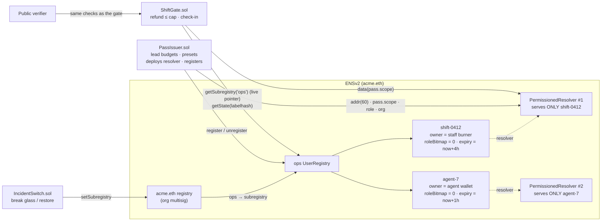

<div align="center">

# OnShift

**Authority that expires.** Verifiable, least-privilege, self-expiring passes for staff and AI agents — built on ENSv2.

`shift-0412.ops.acme.eth` proves to any wallet or contract that its holder acts for **acme.eth** *right now*, lets them touch only what you allow, can never be transferred, and stops working by itself when the shift ends. Nobody has to remember to revoke it.


</div>

---

## The problem

Organisations hand out temporary power all the time: event cashiers, on-call responders during an incident,
contract support staff — and now AI agents that issue refunds or change systems. Today that power is either
**too broad** (a shared admin key) or **never taken back** (a role someone must remember to remove).

Outsiders have it worse. A customer, a counterparty or another contract has **no reliable way to check** whether
the person or agent in front of them acts for the organisation right now. Fake "support agents" in chat channels
exploit exactly that gap.

## What OnShift does

| | |
|---|---|
| **Issue** | A shift lead gives a staff phone or an AI agent wallet a name like `shift-0412.ops.acme.eth` with a role, a spending cap and an end time. One transaction. |
| **Use** | The holder can refund or check in through `ShiftGate`, up to the cap, and update one public status record. They can never redirect payouts, raise their own cap, or hand the pass on. |
| **Expire** | At the end time the pass stops working. No revoke transaction, no cron job. |
| **Verify** | Anyone types the name into a public page and sees **ON SHIFT** / **NOT ON SHIFT**, the role and time left — read straight from Ethereum. Look-alike orgs (`acrne.eth`) are flagged. |
| **Break glass** | One org transaction re-points the `ops` namespace and kills every live pass — humans and agents — at once. Recovery uses a *fresh* namespace, so nothing old comes back. |

<table>
<tr>
<td width="50%"></td>
<td width="50%"></td>
</tr>
<tr>
<td align="center"><b>Issue</b> — role presets, cap, duration; no hashes on screen</td>
<td align="center"><b>Staff app</b> — live countdown, allowed vs. locked actions, misuse attempts refused by the chain</td>
</tr>
<tr>
<td width="50%"></td>
<td>

### Why ENS, and not a JWT or a mapping?

A JWT or an Apple Wallet pass proves something only to the system that issued it. An OnShift pass can be checked by
**anyone** — a customer's wallet, another company's contract, a block explorer — without calling our server, under
the organisation's own human-readable brand.

Remove ENSv2 and you lose: public "on shift?" verification, record-level permissions, non-transferability,
expiry enforced by the registry, and the one-transaction namespace kill switch. `ShiftGate` and the public verifier
are two **independent** readers of the same ENS state.

</td>
</tr>
</table>

---

## How it works



Every gated action re-derives authority from ENS, every call:

1. Follow the parent's **live** `ops` pointer → break-glass kills everything in one transaction.
2. Liveness = registry `getState(labelhash)`: `REGISTERED && now < expiry` — **never** "does the name resolve?".
3. Caller must be `latestOwner` (which ignores expiry — hence step 2 first).
4. Scope (cap, allowed actions) comes from the pass's own resolver, written by the issuer only, and must be bound to
   this exact registration's expiry.

More diagrams (sequence, lifecycle, permission matrix): **[docs/ARCHITECTURE.md](docs/ARCHITECTURE.md)**.

## ENSv2 features doing real work

| ENSv2 feature | What it does in OnShift |
|---|---|
| **Hierarchical registries** | `*.ops.acme.eth` lives in its own UserRegistry; re-pointing `ops` is the break-glass kill switch. |
| **Expiring subnames** | Every pass expires on its own. `ShiftGate` reads expiry from the registry. |
| **Enhanced Access Control** | Passes are registered with `roleBitmap = 0`: no transfer, no resolver change, nothing for approved operators to inherit. |
| **Permissioned Resolver** | One instance per pass. The holder gets a **key-scoped** setter for `shift.status` only; payout address and scope are issuer-only. |
| **Verifiable Factory** | Per-pass resolvers are deterministic EIP-1167 proxies with caller-bound salts. |
| **Agent identity (ENSIP-26)** | AI-agent passes carry an `agent-context` record anyone can read. |

## Subtle ENSv2 pitfalls we designed around

These are the things a sponsor engineer will probe. Each one has a test.

| # | Pitfall | Our design | Test |
|---|---|---|---|
| C1 | Permissioned Resolver roles have **no per-name scoping** — a shared resolver lets staff A overwrite staff B. | One resolver instance per pass. | `test_PerPassResolver_isolatesPasses`, `test_SharedResolver_wouldLetStaffOverwriteEachOther` |
| C2 | Expiry does **not** remove resolver roles; a direct `setText` may still succeed. | Everything that matters goes through `ShiftGate`, which reads the registry. The late write is inert. | `test_Expiry_killsGateWithoutAnyTransaction` |
| C3 | An expired name can fall back to an ancestor's resolver, so "does it resolve?" is not liveness. | Liveness is `getState()` only; `ops` has no resolver and the org resolver keeps no default child records. | `test_Expiry_killsGateWithoutAnyTransaction` |
| C4 | Approved ERC-1155 operators inherit the owner's roles. | `roleBitmap = 0` → nothing to inherit; gate checks `latestOwner`. | `test_Staff_cannotTransferPass_evenViaApprovedOperator` |
| C5 | `renew()` on an expired name **revives** the old owner and roles. | `PassIssuer` holds no `ROLE_RENEW`; and the scope record is bound to the original expiry, so even a multisig renewal is refused (`ScopeMismatch`). | `test_Renew_issuerHasNoRole_andGateRefusesRevivedPass` |
| C7 | Token IDs are mutable (version bumps on re-registration). | Everything keyed by `labelhash`; spend tracked per `(registry, labelhash, expiry)`. | `test_Reissue_newTokenIdAndFreshSpend` |
| C8 | `ROLE_LINK` / text roles are resolver-wide. | `IncidentSwitch` holds only key-scoped setters for `ops.status` and `ops.incident`. | `test_IncidentSwitch_holdsOnlyKeyScopedTextRights` |

## Improvements over the original brief

The design started from a strict judge review of an earlier "DeskPass" idea. On top of that review's fixes we added:

- **Scope bound to expiry** — defence in depth against renewal resurrection (C5), not just a policy.
- **Restore into a fresh registry** — after break-glass, re-pointing back to the old registry would revive every pass; we never do that.
- **Least-privilege incident switch** — key-scoped text setters instead of a resolver-wide role.
- **Action-scoped roles** — presets carry an action bitmask (`refund`, `check-in`) enforced by the gate. "Door staff" can check people in but cannot move money.
- **Bounded blast radius, everywhere** — per-lead daily budgets, per-pass caps, `MAX_DURATION`, a capped gas drip, and a gate float that is the system-wide maximum loss.
- **Look-alike detection** in the public verifier (`acrne.eth` vs `acme.eth`).
- **Gas-free misuse demo** — the staff app simulates forbidden actions so you can watch the chain refuse them.
- **Chain-time countdowns** and an auto-refreshing verifier that flips to NOT ON SHIFT at expiry, live.
- **One-command local demo** and a scripted AI agent that refunds until the cap stops it.

---

## Quickstart

Requirements: [Foundry](https://getfoundry.sh) and Node.js 20+.

```bash
git clone <this repo> onshift && cd onshift
npm install
npm run dev
```

`npm run dev` starts Anvil with one-second blocks, deploys the full system, exports addresses and ABIs to the app,
and serves it at **http://localhost:5173**. Nothing is hard-coded: the app reads `contracts/deployments/<chainId>.json`.

Then, in another terminal:

```bash
npm run agent
```

An AI agent gets a $20 pass and refunds $5 per order until the chain stops it with `OverCap`.

| Command | What it does |
|---|---|
| `npm run dev` | Local chain + deploy + web app |
| `npm test` | 25 Foundry tests, including a fuzz test that spend never exceeds the cap |
| `npm run test:gas` | Gas report |
| `npm run agent` | AI-agent demo against the running chain |
| `npm run build` | Contracts, ABI export, typecheck and production build of the app |

### Using the app

The **Acting as** switcher in the top bar picks who signs: *Org admin* (the multisig), *Shift lead*, *AI agent*, or a
*Staff device* (a burner key generated in your browser, exactly as a staff phone would). These are Anvil's public
development keys and only touch the local chain.

A 4-minute walkthrough lives in **[docs/DEMO_SCRIPT.md](docs/DEMO_SCRIPT.md)**.

## Contracts

| Contract | Role |
|---|---|
| [`PassIssuer.sol`](contracts/src/PassIssuer.sol) | Leads, daily budgets, role presets. Deploys a resolver per pass, writes issuer-only records, registers with `roleBitmap = 0`, forwards a gas drip. `revokeNow()`. No `renew()`. |
| [`ShiftGate.sol`](contracts/src/ShiftGate.sol) | Capped refunds and check-ins. Liveness from `getState()` on the live `ops` pointer, holder = `latestOwner`, scope from the pass resolver. Replay protection. `passStatus()` for verifiers. |
| [`IncidentSwitch.sol`](contracts/src/IncidentSwitch.sol) | Break glass (re-point `ops` to an empty registry + publish `ops.status = incident`) and restore into a fresh registry. |
| [`ensv2-local/`](contracts/src/ensv2-local) | A compact implementation of the ENSv2 registry / resolver / factory **semantics** OnShift relies on, so the whole system runs and is tested locally. |

### Gas (Foundry gas report, local)

| Action | Gas (median) | Note |
|---|---|---|
| `issue` | ~719k | Dominated by deploying the per-pass resolver proxy and writing its records |
| `refund` | ~68k | |
| `checkIn` | ~87k | |
| `revokeNow` | ~44k | |
| `breakGlass` | ~117k | Kills every live pass |

Per-pass resolvers are the right trade for authority worth protecting (treasury operators, support desks, agents
with spending rights). For thousands of low-value badges you would use one custom resolver that enforces "only the
live holder may write these keys" — at the cost of not using the stock Permissioned Resolver.

## Status: local ENSv2 layer vs. Sepolia

The contracts compile against **interfaces** named after the ENSv2 docs (`IPermissionedRegistry.getState`,
`register`, `unregister`, `getSubregistry`, `grantSetterRoles`-style key-scoped setters). Locally they run on
`contracts/src/ensv2-local`, which reproduces the exact behaviours the design depends on — mutable token IDs,
`latestOwner` ignoring expiry, `renew()` reviving roles, resolver-wide roles, operator role inheritance.

Pointing OnShift at the deployed ENSv2 contracts on Sepolia is the remaining step before submission to the ENS
track; the mapping, the open questions to confirm with the ENS team and the deployment plan are in
**[docs/ENSV2_MAPPING.md](docs/ENSV2_MAPPING.md)**. We say this plainly because the track asks for ENSv2 on
Sepolia or mainnet.

## Security

Threat model, residual risks and trust assumptions: **[docs/THREAT_MODEL.md](docs/THREAT_MODEL.md)**.
Short version: a stolen staff phone is bounded by the remaining cap of one shift; a stolen lead key by
`budget × cap`; anything wider is stopped by break-glass; and the gate float bounds the total.

## Repository layout

```
contracts/          Foundry project
  src/              PassIssuer, ShiftGate, IncidentSwitch, OnShiftTypes
  src/ensv2-local/  Local ENSv2-semantics registry, resolver, factory
  script/           Deploy.s.sol + shared OnShiftDeployer
  test/             OnShift.t.sol (25 tests incl. fuzz)
app/                Vite + React + viem, neumorphic management UI
scripts/            dev orchestration, ABI export, AI-agent demo
docs/               architecture, threat model, demo script, ENSv2 mapping, judge Q&A
```

## Judges' questions

The hard questions — *why not a JWT? why a resolver per pass? what exactly happens at expiry? what if a phone is
stolen?* — and our answers: **[docs/JUDGE_QA.md](docs/JUDGE_QA.md)**.

## License

MIT
